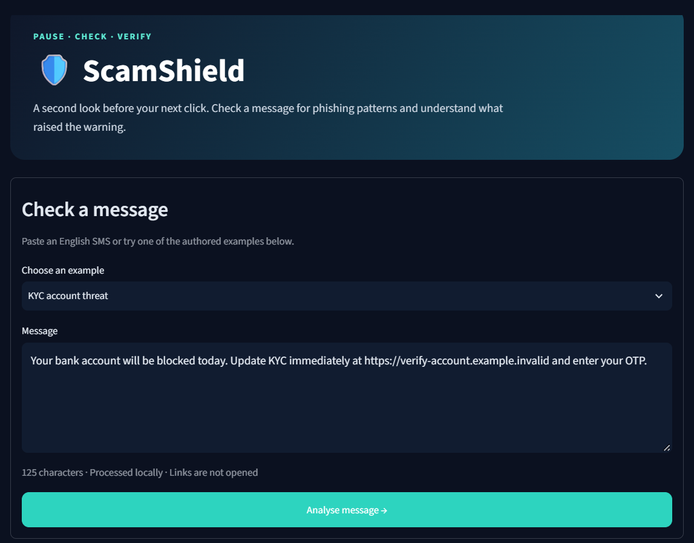
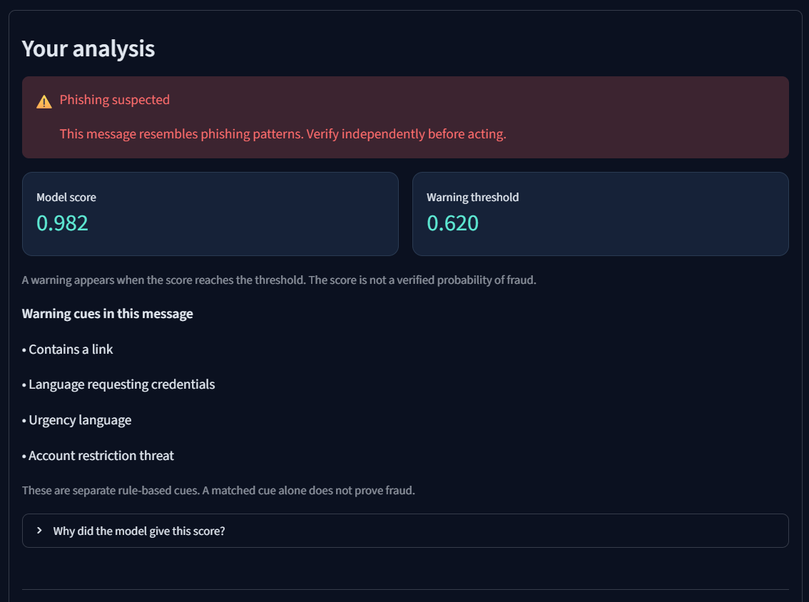

# 🛡️ ScamShield

**Explainable SMS phishing detection for financial safety.**

ScamShield is a Pattern Recognition semester project that screens English messages for SMS phishing, or *smishing*, patterns. A Streamlit dashboard lets users paste a message, inspect a warning decision, and understand the features associated with that decision.

The project combines classical machine learning, reproducible notebook experiments, and a local working demonstration. India-focused examples illustrate financial messaging scenarios such as KYC threats and requests to disclose UPI credentials.

## Dashboard




## Features

- Dark dashboard with a navy-and-teal theme.
- Paste an English message or select an authored demonstration example.
- Phishing screening using a saved machine-learning pipeline.
- Clear warning decision, model score, and operating threshold.
- Additive feature contributions explaining the model's score.
- Separate rule cues for urgency, credential requests, rewards, links, advance payments, and account threats.
- Jupyter notebook with data inspection, model comparisons, error analysis, and report figures.
- Local inference without paid APIs or live website access.

## Problem statement

Develop and evaluate a lightweight supervised pattern recognition system that distinguishes SMS phishing from non-phishing messages using textual and structural features, and presents interpretable warnings through a web application.

The positive class is **smishing**. The benchmark's **ham** and **spam** labels form the non-phishing class. Non-phishing means the model has not detected a phishing pattern; it does not certify that a sender or offer is genuine.

## Dataset

The project uses **SMS Phishing Dataset for Machine Learning and Pattern Recognition**, published by Sandhya Mishra and Devpriya Soni on Mendeley Data, Version 1 (2022).

- [Original dataset](https://data.mendeley.com/datasets/f45bkkt8pr/1)
- DOI: `10.17632/f45bkkt8pr.1`
- Dataset licence: **CC BY 4.0**
- [Research mirror used by the training script](https://github.com/AbeerAlhuthali/PhishNet)
- Mirror file: `PhishNet_Dataset1_original.csv`

The mirror describes its copy as unmodified. Byte identity against a separate original download was not independently verified. The training audit records the downloaded file's SHA-256 checksum.

| Original class | Records |
|---|---:|
| Ham | 4,844 |
| Spam | 489 |
| Smishing | 638 |
| **Total** | **5,971** |

### Cleaning and partitioning

1. Standardise label capitalisation and inspect missing text.
2. Identify identical messages after lowercasing and whitespace normalisation.
3. Exclude groups with contradictory binary targets.
4. Remove repeated normalised messages.
5. Group message templates after collapsing URL strings and digit sequences.
6. Keep each template group entirely within one partition.

The recorded experiment excluded **68 ambiguous rows** and removed **106 additional duplicate rows**, retaining **5,797 messages**. Of these, **528** were labelled phishing and **5,269** non-phishing.

| Partition | Messages | Phishing | Non-phishing |
|---|---:|---:|---:|
| Training | 3,477 | 317 | 3,160 |
| Validation | 1,159 | 105 | 1,054 |
| Test | 1,161 | 106 | 1,055 |

This is one deterministic grouped split approximating 60/20/20. Template grouping reduces leakage but cannot identify every paraphrase or shared campaign.

## Methodology

### Feature representations

| Representation | Configuration |
|---|---|
| Word TF-IDF | Word unigrams and bigrams; up to 15,000 features |
| Character TF-IDF | Character boundary n-grams of lengths 3–5; up to 20,000 features |
| Structural features | Link presence, credential-request language, urgency, rewards, advance payments, account threats, message length, and digit fraction |

Both TF-IDF vectorizers use minimum document frequency 2 and sublinear term frequency. Vocabularies and classifiers learn from training messages only.

### Models and baselines

- Majority-class prediction.
- Rule baseline requiring at least two warning cues.
- Word TF-IDF with Multinomial Naive Bayes.
- Word TF-IDF with Logistic Regression.
- Word TF-IDF with Linear SVM.
- Character TF-IDF with Logistic Regression.
- Combined word and character Logistic Regression.
- Hybrid Logistic Regression using word, character, and structural features.

Thresholds maximise phishing F1 on validation messages, with precision breaking ties. The deployed model is selected among Logistic Regression variants using validation results. This restriction supports consistent additive explanations. Test results do not determine the deployed model or its threshold.

## Recorded results

The following are measured results from the bundled experiment, not performance guarantees for current Indian users.

| Model | Phishing precision | Phishing recall | Phishing F1 |
|---|---:|---:|---:|
| Word Naive Bayes | 0.8750 | 0.7925 | 0.8317 |
| Word Logistic Regression | 0.9029 | 0.8774 | **0.8900** |
| Word Linear SVM | 0.9247 | 0.8113 | 0.8643 |
| Character Logistic Regression | 0.8889 | 0.8302 | 0.8585 |
| Word + Character Logistic Regression | 0.8990 | 0.8396 | 0.8683 |
| **Hybrid Logistic Regression — deployed** | **0.8440** | **0.8679** | **0.8558** |
| Majority baseline | 0.0000 | 0.0000 | 0.0000 |
| Two-cue rule baseline | 0.9412 | 0.1509 | 0.2602 |

The hybrid model had the highest validation F1 among the eligible representations, so it was selected for deployment at threshold **0.62**. On the held-out test set it produced:

- **92 true positives** and **14 false negatives**.
- **17 false positives** and **1,038 true negatives**.
- **97.33% accuracy** and **1.61% false-positive rate**.
- **0.9426 average precision**.

**The word-only Logistic Regression baseline achieved a higher test F1 than the hybrid.** Added features did not establish a held-out improvement in this run. This finding is retained in the report and is part of the project's analysis.

The model score is not a verified or independently calibrated probability of fraud. Positive feature contributions describe learned associations; rule cues are a separate explanation layer.

## Technology stack

| Tool | Purpose |
|---|---|
| Python | Implementation |
| pandas and NumPy | Data processing |
| scikit-learn | Feature extraction, classifiers, splitting, and evaluation |
| Matplotlib | Report figures |
| Jupyter | Reproducible experimental walkthrough |
| Streamlit | Interactive dashboard |
| joblib | Saved model pipeline |

Exact dependency versions are recorded in `requirements.txt`.

## Run locally on Windows

Python **3.11 or 3.12** is recommended. Open the project folder containing `app.py` in VS Code, then select **Terminal → New Terminal**.

Run each command separately:

```powershell
py -m venv .venv
.\.venv\Scripts\python.exe -m pip install -r requirements.txt
.\.venv\Scripts\python.exe train.py
.\.venv\Scripts\python.exe -m streamlit run app.py
```

If `py` is unavailable, use `python -m venv .venv` for the first command.

The training script downloads the dataset from the research mirror if `data/raw.csv` is missing. The first dependency installation and dataset download require internet. Once the packages, data and model are present, the demo runs locally.

Open [http://localhost:8501](http://localhost:8501) if the browser does not open automatically. Keep the terminal running; press **Ctrl+C** to stop the app.

### Avoid Anaconda and virtual-environment mismatches

Use the full interpreter commands above, even if the terminal displays `(.venv)`. A bare `streamlit run app.py` may launch Streamlit from another Python installation.

Check the environment with:

```powershell
.\.venv\Scripts\python.exe -c "import sys, sklearn; print(sys.executable); print(sklearn.__version__)"
```

The interpreter should point to this project's `.venv`, and scikit-learn should match `requirements.txt`. If a saved model triggers a version warning, stop the app, install the pinned dependencies, retrain using that interpreter, and launch Streamlit through the same interpreter.

### Open the notebook

1. Run `train.py` first, especially after cloning a repository without generated data.
2. Open `ScamShield.ipynb` in VS Code.
3. Select the `.venv` interpreter as the notebook kernel.
4. Run cells in order.

The notebook calls the same training function used by `train.py`. Outputs include cleaning audits, grouped partitions, validation selection, held-out metrics, figures, and error examples.

## Project files

| Path | Purpose |
|---|---|
| `app.py` | Streamlit dashboard |
| `core.py` | Shared features, warning cues, and explanations |
| `train.py` | Complete training and evaluation pipeline |
| `ScamShield.ipynb` | Notebook walkthrough |
| `requirements.txt` | Pinned dependencies |
| `.streamlit/config.toml` | Dashboard theme |
| `data/demo_examples.json` | Manually authored demonstration scenarios |
| `data/raw.csv` | Downloaded benchmark; generated locally |
| `data/train.csv`, `validation.csv`, `test.csv` | Generated partitions |
| `models/scamshield.joblib` | Generated saved pipeline |
| `outputs/` | Audits, metrics, predictions, and figures |
| `assets/dashboard.png` | Dashboard screenshot used in this README |
| `VIVA_GUIDE.md` | Questions and explanations for the viva |
| `ScamShield_Report.docx` | Project report draft, if included |

## Add the dashboard screenshot

Create an `assets` folder in the project root and save the screenshot as **`assets/dashboard.png`**. The image near the top of this README will then render on GitHub. Use a demonstration message rather than a screenshot containing personal financial information.

## Scope and limitations

- The system recognises English SMS phishing patterns; it does not authenticate senders or verify financial offers.
- It does not open links or inspect destination websites.
- The public benchmark is older and contains label inconsistencies.
- False positives and missed phishing messages remain possible.
- India-focused examples are manually authored demonstrations, not an independent representative benchmark.
- Hindi, Hinglish, voice calls and conversational scams have not been validated.
- Actual financial-loss prevention has not been measured.
- The app processes messages locally and does not deliberately save submitted messages.

Future work includes an independently annotated Indian dataset, multilingual evaluation, probability calibration, and evaluation across multiple grouped or temporal splits.

## Attribution

**Dataset:** S. Mishra and D. Soni, “SMS PHISHING DATASET FOR MACHINE LEARNING AND PATTERN RECOGNITION,” Mendeley Data, V1, 2022, DOI: `10.17632/f45bkkt8pr.1`, CC BY 4.0.

**Related research:**

- S. Mishra and D. Soni, “Smishing Detector: A security model to detect smishing through SMS content analysis and URL behavior analysis,” *Future Generation Computer Systems*, vol. 108, pp. 803–815, 2020. [DOI](https://doi.org/10.1016/j.future.2020.03.021)
- S. Mishra and D. Soni, “DSmishSMS-A System to Detect Smishing SMS,” *Neural Computing and Applications*, vol. 35, no. 7, pp. 4975–4992, 2023. [DOI](https://doi.org/10.1007/s00521-021-06305-y)

The dataset licence applies to the dataset. A separate licence for this project's code may be added by the repository owner.
